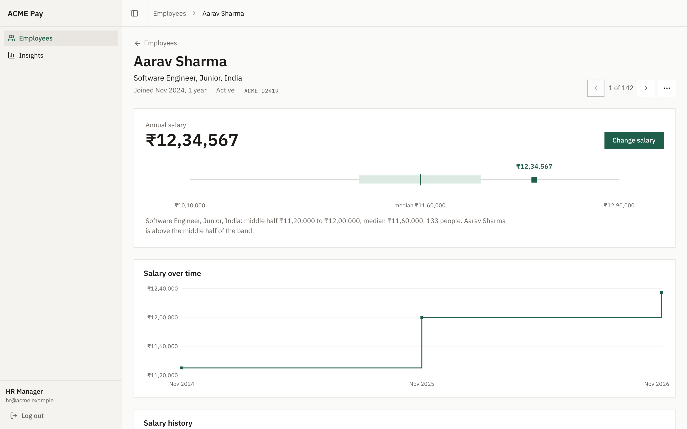
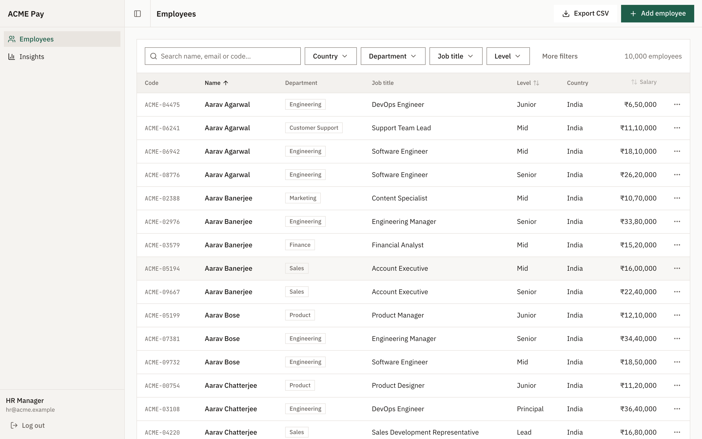
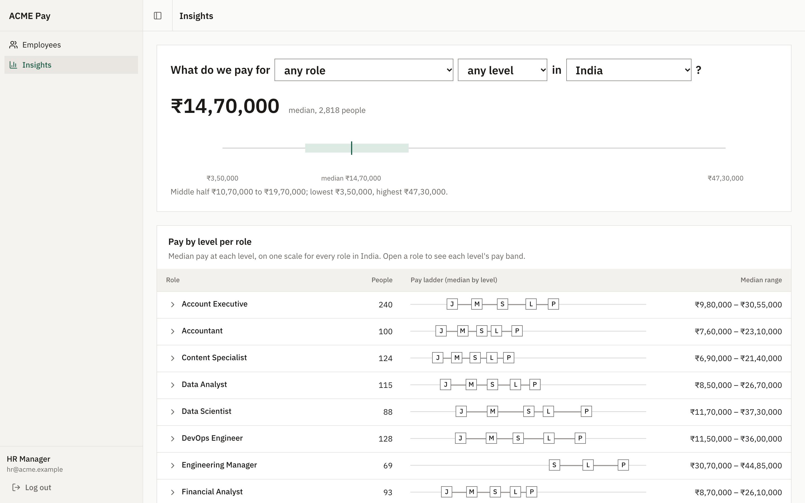

# ACME Salary Management

A web app that replaces ACME's Excel sheets. The HR Manager uses it to manage salaries for 10,000 employees and to answer questions like *"What is the median salary of a Software Engineer in India?"*



<p>
  
  
</p>

## For reviewers

| | |
|---|---|
| **Live app** | https://ledgerline-theta-bice.vercel.app. The free API sleeps when idle: the first visit can take a minute, and the app says so while it waits |
| **Login** | `hr@acme.example` / `hr@123`. Short on purpose so reviewers log in fast. It skips the 12-character rule the seed enforces (`config.seed.adminPasswordMinLength`) and would be rotated after the review |
| **Demo video** | [Google Drive](https://drive.google.com/file/d/17tsxsk26Fb6Bz4_AvJNQNc19jYaQf4q3/view?usp=drive_link) |
| **Stack** | TypeScript everywhere · React + Vite + shadcn/ui · Fastify · PostgreSQL + Kysely · Zod shared by API and UI · Vitest + Playwright |

**Where to look, by question:**

| If you want to know… | Read |
|---|---|
| What was built and what was left out, and why | [docs/requirements.md](docs/requirements.md) (written before any code) |
| How it fits together | [Diagram](https://excalidraw.com/#json=qXfSBfsghaeuzmqknR7Ai,SjkORtY0JrrfZWGS1sFmmA) · [docs/system-design.md](docs/system-design.md) |
| Why each choice was made | [Trade-offs below](#design-decisions-and-trade-offs) · all of them in [docs/decisions.md](docs/decisions.md) |
| How the work was done (TDD, commits) | [CONTRIBUTING.md](CONTRIBUTING.md), with a guide to [reading the commit history](CONTRIBUTING.md#reading-the-commit-history) |
| How AI was used and where it was wrong | [How I used AI](#how-i-used-ai) · [docs/ai-prompts.md](docs/ai-prompts.md) |
| What went wrong while building | [docs/lessons.md](docs/lessons.md) |

## What it does, and the proof

Each requirement from [docs/requirements.md](docs/requirements.md), how it's met, and the test that fails if it breaks.

| Requirement | How | Evidence |
|---|---|---|
| Only logged-in HR users see data | httpOnly session cookie stored in Postgres. Every route is protected unless it's listed as public | `every non-public route is 401 without a session` in [auth/routes.db.test.ts](apps/api/src/modules/auth/routes.db.test.ts) |
| A sixth failed login within a minute is blocked | Rate limit per IP + email | `rate-limits the 6th login attempt in a minute` in the same file |
| Find anyone fast (search, filter, sort, paging) under 200 ms | Server-side filters, trigram index for search, filter state in the URL | [filters.db.test.ts](packages/db/src/repositories/filters.db.test.ts) · `pnpm bench` in CI fails if list p95 > 200 ms (about 14 ms on 10k rows) |
| Create, view, edit, delete; a duplicate email gets a clear error | Shared Zod validation; partial unique index on active rows | `creates (201) and rejects a duplicate email with EMAIL_TAKEN` in [employees/routes.db.test.ts](apps/api/src/modules/employees/routes.db.test.ts) |
| A salary change is never half-saved, and history is kept | New salary and its history row are written in one transaction | `changes salary, writes history (newest first, with changer name), 409 when stale` in the same file |
| Two HR users editing one record: the second is told to reload | Optimistic locking with a `version` column → `409 STALE_VERSION`; the form reloads and keeps your input | `two simultaneous salary edits…: one wins, one is stale` in [employee-repository.db.test.ts](packages/db/src/repositories/employee-repository.db.test.ts) · [EmployeeDetailPage.test.tsx](apps/web/src/features/employees/detail/EmployeeDetailPage.test.tsx) |
| CSV export of the filtered list | Streamed from the same filters as the list | `exports filtered rows in major units…` in [employees/routes.db.test.ts](apps/api/src/modules/employees/routes.db.test.ts) |
| 10,000 realistic employees, the same on every run | Fixed random seed; salaries inside bands; history ends at the current salary | [seed/generate.test.ts](packages/db/src/seed/generate.test.ts) |
| Pay insights: median, range, distribution, gender gap | Exact stats in SQL, per country in local currency | `computes exact stats per group…` in [insights-repository.db.test.ts](packages/db/src/repositories/insights-repository.db.test.ts) |
| Salaries never reach the logs | 5xx logs keep only type, message, code and stack | `never writes salary values or cookies to the logs` in [errors.test.ts](apps/api/src/errors.test.ts) |
| The critical path works in a real browser | Log in → search → change salary → see it in history | [e2e/smoke.spec.ts](e2e/smoke.spec.ts) |

## Run locally

Needs Node 26+, pnpm and Docker.

```sh
cp .env.example .env
docker compose up -d db
pnpm install
pnpm db:setup   # migrate, then seed 10,000 employees (same data every run)
pnpm dev        # API on :3000, web on :5173
```

## Tests and checks

About 310 tests, 95% line coverage. They run against a real Postgres, with no mocked database. CI runs every row below on each push and PR ([ci.yml](.github/workflows/ci.yml)).

| What | Command |
|---|---|
| Everything below in one go: typecheck, lint, format, DB types up to date, all tests, coverage floor | `pnpm check` |
| Unit: money, validation, services with fake repositories | `pnpm test --project unit` |
| Web: components and hooks (jsdom) | `pnpm test --project web` |
| DB: repositories and routes against Postgres | `pnpm test --project db` |
| Browser smoke test on its own DB and ports (first run: `pnpm exec playwright install chromium`) | `pnpm e2e` |
| List latency p95 vs the 200 ms target on the seeded 10k rows | `pnpm bench` |
| Every check, deploy, then wait for production to run this commit and smoke-test it | `pnpm ship` |

## How it works

```
apps/web  (React SPA)  ──/api/*──►  apps/api  (Fastify: routes → services)  ──►  packages/db  (Kysely, SQL, migrations, seed)  ──►  Postgres
                └──────────── packages/shared (Zod validation, money, error codes, config) ────────────┘
```

- Modular monolith, split by feature. Routes validate input, services hold the rules, repositories in `packages/db` are the only place that writes SQL.
- Vercel proxies `/api/*` to Render, so the browser sees a single origin. Details: [docs/deploy.md](docs/deploy.md).
- More: [API](docs/api.md) · [errors](docs/error-handling.md) · [folder structure](docs/structure.md) · [UI design](docs/ui-design.md) · [coding standards](docs/coding-standards.md)

## Design decisions and trade-offs

| Chose | Over | Why | Trade-off |
|---|---|---|---|
| Modular monolith: routes → services → repositories | Microservices | One team, ~5 req/s. Clear layers keep it testable and easy to split later | Parts can't scale on their own |
| One TypeScript monorepo, Zod schemas shared by API and UI | Separate repos, per-app validation | Same rules and types on both sides, so they never drift | The packages are coupled through `shared` |
| PostgreSQL + Kysely (SQL migrations, generated types) | Prisma, MongoDB | Relational data and real transactions. Partial unique indexes and medians would be raw SQL in Prisma anyway ([comparison](docs/decisions.md#why-kysely-over-prisma)) | Migrations are written by hand |
| Salary change in one transaction + optimistic locking (`version`) | Updating salary inside `PATCH`, row locks | Never half-saved, and no lost updates without holding locks | The client must send `version` and handle `409` |
| httpOnly session cookie stored in Postgres | JWT in localStorage | Safe from XSS, and logout really ends the session | One DB read per request |
| Money as integer minor units (`BIGINT`), local currency | Floats, FX conversion | No rounding errors, no external rate dependency | No cross-country salary comparison |
| No cache, queue or load balancer | Redis, workers, N instances | 10k rows: queries take a few ms, so fewer moving parts | Needs adding at scale ([when](docs/system-design.md#trade-offs)) |

## How I used AI

Claude Code was the pair programmer. I made the product and design decisions. AI proposed options, wrote code test-first and reviewed its own work.

- **Requirements:** about 50 questions in rounds (a custom `drillme` skill in [.claude/skills](.claude/skills)). I accepted, changed or rejected each answer, and the results went into `docs/`.
- **Build:** a lead agent wrote the contracts, then gave scoped tasks to parallel agents, each in its own git worktree with its own test DB. I reviewed every merge.
- **UI:** a design skill for the direction, then an accessibility and UX audit of each screen.
- **Where I overruled it:** MUI → shadcn, USD conversion → local currency only, `int` → `bigint` ids, and more.

Full write-up, including the AI's mistakes and how they were caught: [docs/ai-prompts.md](docs/ai-prompts.md).

## What I'd improve next

- Roles and SSO with row-level security, once managers and employees use it.
- Observability (OpenTelemetry metrics, traces, alerts) instead of request logs only.
- At scale: cursor pagination, a read replica and a cache for insights ([scaling plan](docs/system-design.md#scaling-later-designed-not-built)).
